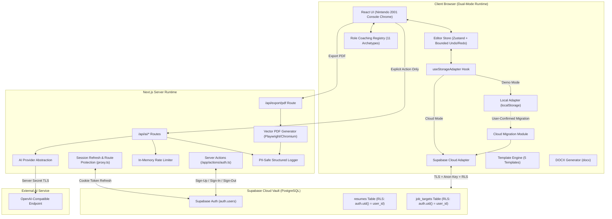

# SoftCV Studio — System Architecture

**Document Reference:** `DOC-ARCH-2026-V3`  
**Status:** Implemented & Verified (Sprint 08)  
**UI/UX Identity:** Nintendo.com 2001 / Console Chrome ([`docs/DESIGN.md`](file:///c:/Users/Samujwal/OneDrive/Desktop/resumebuilder/docs/DESIGN.md))  

---

## 1. Architectural Overview

SoftCV Studio is structured as a dual-mode hybrid web application built on **Next.js 16 (App Router)** and **TypeScript**. It supports:
1. **Local-First Demo Mode**: 100% offline-capable, storing data strictly in the browser's `localStorage` without requiring external credentials.
2. **Authenticated Cloud Mode**: Secure cloud synchronization backed by **Supabase (PostgreSQL)** with Row-Level Security (RLS) and cookie-managed sessions via `@supabase/ssr`.

---

## 2. Core Subsystems

### 2.1 Persistence Layer & Dual Adapters
- **Storage Hook (`useStorageAdapter`)**: Inspects Supabase configuration and user session. Resolves `localAdapter` in standalone demo mode or `createSupabaseAdapter(supabase, userId)` in authenticated cloud mode.
- **Local Persistence (`local-adapter.ts`)**: Manages `softcv_resumes_*` and `softcv_resume_index`. Features atomic index writes, tombstone deletion guards (preventing resurrection races from late debounced autosaves), and complete JSON backup export.
- **Cloud Persistence (`supabase-adapter.ts`)**: Communicates with Supabase using `@supabase/ssr` browser client. Enforces pre-write Zod validation (`ResumeDocumentSchema.parse`) and redundant `assertOwnership` checks before persisting records to `resumes` and `job_targets` tables.
- **Migration Pipeline (`cloud-migration.ts`)**: Provides user-directed, reviewable, idempotent migration of local cartridges to the authenticated cloud vault. Excludes synthetic specimens by default and retains local records until the user explicitly confirms post-migration cleanup.

### 2.2 Authentication, Route Protection & Proxy Convention (RS-046)
- **Official SSR Integration**: Uses `@supabase/ssr` cookie helpers to manage user sessions across Server Components, Server Actions, and Route Handlers.
- **Server Actions (`src/app/actions/auth.ts`)**: Handles email/password sign-up, sign-in, and sign-out server-side. Passwords and credentials never touch client-side state.
- **Next.js 16 Proxy Convention (`src/proxy.ts`)**: Migrated from deprecated `middleware.ts` to `export async function proxy(request: NextRequest)`. Refreshes session tokens on incoming requests. In Cloud Mode, protects `/dashboard` and `/resume/*` by redirecting unauthenticated visitors to `/auth/login`. In Demo Mode (no Supabase env vars), acts as a transparent passthrough. Preserves response cookie headers and eliminates Next.js 16 framework deprecation warnings.

### 2.3 Document Schema & Migration Subsystem
- **Canonical Schema (`src/lib/schemas/resume.ts`)**: Versioned Zod schema (`schemaVersion: 1`) enforcing strict boundaries (e.g. name ≤ 120 chars, bullets ≤ 400 chars, max 20 bullets/item).
- **Schema Migrations (`src/lib/schemas/migrations.ts`)**: Deterministic migration framework upgrading older or unversioned records without data loss.

### 2.4 ATS Heuristic Engine & Job Matching
- **ATS Rules Engine (`src/lib/ats/engine.ts`)**: Pure deterministic evaluator analyzing parse readiness, content completeness, and writing quality without external network calls.
- **Job Matching Subsystem (`src/lib/ats/job-match.ts`)**: Matches resume evidence against job requirements using a comprehensive tech synonym map (`SYNONYM_MAP`) while preserving truthfulness.

### 2.5 Export Engine
- **Vector PDF Generator (`src/lib/export/pdf-generator.ts`)**: Headless Chromium via Playwright executing vector printing with selectable text, pagination, and A4/US Letter dimensions.
- **DOCX Compiler (`src/lib/export/docx-export.ts`)**: Generates linear Microsoft Word files using standard typography and heading levels without tables.

### 2.6 Role-Specific Coaching Presets Subsystem (RS-093)
- **Preset Registry (`src/lib/coaching/presets.ts`)**: 11 typed role archetypes providing role descriptions, evidence expectations, sample keywords, synthetic bullet examples (clearly labelled, never auto-inserted), and fresher vs experienced guidance.
- **Section Architecture Preview (`RoleCoachingModal`)**: Non-destructive comparison dialog showing current vs recommended section ordering. Applying a preset reorders sections while guaranteeing 100% preservation of all fields and data.
- **AI Prompt Integration (`src/lib/ai/prompts.ts`)**: Injects role-specific framing and evidence criteria into bullet improver and summary helper prompts while strictly forbidding hallucination of absent technologies or seniority levels.

### 2.7 Bounded Undo/Redo & State History (RS-072)
- **Bounded State Ring (`src/lib/resume/editor-store.ts`)**: In-memory ring buffer capped at 30 snapshots (`MAX_HISTORY = 30`). Snapshots cover semantic resume edits only, excluding transient UI state.
- **Keystroke Grouping Window**: Debounces rapid text inputs within a 600ms window (`GROUPING_WINDOW_MS = 600`) to cluster typing runs into logical atomic undo steps.
- **AI Rollback Integration**: Discrete snapshots captured prior to applying AI suggestions (`replaceDraft`), enabling one-click undo if the user changes their mind.
- **Console Chrome Controls (`UndoRedoControls`)**: Accessible UI with keyboard shortcuts (Ctrl+Z, Ctrl+Y, Ctrl+Shift+Z), disabled state semantics, and polite `aria-live` status announcements.

### 2.8 Database Isolation & Verification Subsystem (RS-172)
- **pgTAP Isolation Test Suite (`docs/supabase/tests/rls_isolation_tests.sql`)**: PostgreSQL database test file verifying RLS enablement, anonymous user blocking, User A CRUD, User B isolation across SELECT/UPDATE/DELETE, forged user_id INSERT rejection, and cascade deletion.
- **Two-Account Browser Staging Harness (`docs/supabase-staging-test.md`)**: Comprehensive runbook for deploying disposable staging projects, provisioning test users, and validating cross-user security boundaries.
- **Client Cloud Invariants (`tests/cloud-invariants.test.ts`)**: Automated test suite validating demo fallback, offline local persistence, failed cloud save error handling, and scoped storage purge.

### 2.9 Job-Specific Resume Branching & Cartridge Lineage (RS-094)
- **Branching Flow (`TailorResumeModal`, `createTailoredCopy`)**: Enables candidates to branch an independent tailored cartridge from any existing master or source resume.
- **Master Immutability Guarantee**: Uses `structuredClone()` to ensure 100% memory and storage independence across all repeatable collections (experience, bullets, projects, skills, education, custom sections). Editing a tailored copy never mutates the master cartridge.
- **Lineage Metadata**: Tracks `parentResumeId`, `targetRole`, and `targetCompany`. Telemetry is displayed in dashboard cartridge slots and the editor command bar (`◈ TAILORED // <Role>`).
- **Atomic Rollback & Deletion Safety**: If the associated `JobTarget` fails to save, the newly created variant is rolled back atomically. Deleting a tailored copy purges only its record and job target without affecting master or sibling cartridges. Deleting a master cartridge leaves derived copies accessible with parent reference set to null.

### 2.10 Multi-Template Export Regression Matrix (RS-173)
- **Parametrized Verification Matrix (`tests/export-regression-matrix.test.ts`)**: Automated test matrix validating actual binary outputs across all 5 implemented launch templates (Classic ATS, Fresher/Graduate, Modern Editorial, Technical/Project-First, Experienced Professional; Creative deferred) and 6 content profiles.
- **Binary Inspection**: Validates real PDF byte streams via `pdf-parse` (signature, page counts, candidate text, reading order) and OpenXML DOCX packages via `JSZip` (validating `<w:document>`, native `<w:numPr>` bullets, hyperlinks, and page twip dimensions: `11906` for A4, `12240` for US Letter).
- **Zero-Overflow Layout Assertion**: Playwright headless Chromium evaluation guaranteeing `scrollWidth <= clientWidth + 2px` across dense technical and long URL profiles.

### 2.11 Resume Readiness Explainability & Rules Catalog Subsystem (RS-095)
- **Rules Catalog Single Source of Truth (`src/lib/ats/rules-catalog.ts`)**: Centralizes all 24+ deterministic readiness criteria across Parse Readiness, Content Completeness, Writing Quality, and Job Match into typed definitions with explicit pass conditions, evaluator descriptions, parser rationales, and actionable remediations.
- **Deterministic Scoring Formulas**:
  - Structural, Completeness & Writing: `Score = 100 - (Errors × 25) - (Warnings × 10) - (Suggestions × 3)` bounded `[0, 100]`.
  - Job Match Keyword Alignment: `Match % = (Matched Priority Keywords / Total Extracted Keywords) × 100%`, with weighted priorities (Required 3x, Preferred 1.5x, Responsibilities 1x).
- **Explainability Interface (`AtsReadinessPanel`)**:
  - **"HOW THIS IS SCORED" Disclosure**: Collapsible hardware cards displaying exact formula breakdown, deduction tables, score band interpretations (Optimal/Ready, Needs Attention, Critical Issues), and explicit heuristic guidance disclaimers.
  - **Filter Affordances**: Segmented controls toggle between All Checks, Incomplete, and Passed views.
  - **Expandable Check Details**: Reveals what is evaluated, pass condition, observed candidate data/trigger, and recruiter rationale.
### 2.12 Side-by-Side Keyword Evidence Locator & Portability Subsystem (RS-096 / RS-097)
- **Keyword Evidence Locator (`src/components/resume-editor/keyword-evidence-locator.tsx`)**:
  - **Single Source of Truth**: Reuses existing deterministic offline matching in `src/lib/ats/job-match.ts` (`findRequirementEvidence` / `evaluateJobRequirementsCoverage`). Guarantees 100% agreement between displayed job-match percentage and itemized evidence findings.
  - **Deterministic Normalization & Snippets**: Normalized using `normalizeKeyword` (diacritic folding, punctuation stripping, word-boundary preservation). Verbatim quotes are generated using `generateExcerpt`, providing surrounding context without manufacturing text.
  - **Multiple-Occurrence Disclosure**: Renders primary evidence with section tag and excerpt; additional occurrences can be expanded on demand without cluttering the dual-column view.
  - **Grounded Gap Inferences**: Unmet requirements provide grounded suggestions via `inferSuggestedSection` (e.g. technical tools suggest Technical Skills or Projects; degrees suggest Education; responsibilities suggest Experience) without claiming false certainty.
  - **Truthfulness & Ethical Guardrails**: Displays clear heuristic disclosures stating that keyword presence does not guarantee ATS acceptance or qualification. Explicitly warns candidates to add missing terms only if they genuinely possess the capability and can substantiate it in an interview. Content is never automatically inserted into the resume draft.
  - **Non-Destructive Navigation**: Activates `useEditorStore.getState().navigateToSection(...)` to switch the editor section tab and activate `locatorTarget`. Neither draft state nor undo/redo history is mutated. An amber `LocatorTargetBanner` in `src/app/resume/[resumeId]/edit/page.tsx` renders focused keyword telemetry with a quick `← ATS REVIEW` return link.
- **Two-Way JSON Resume Portability (`src/lib/export/json-resume.ts`)**:
  - Implements official JSON Resume v1.0.0 mapping with SoftCV extensions (`x-softcv`), bounded file size (1MB limit), safe Zod schema validation, text-node rendering (zero HTML injection), and non-destructive cartridge creation. Accessible via `DataPrivacyDialog` and `TemplateSettingsPanel`.

---

## 3. Operational Constraints & Deployment Guidance

### 3.1 AI Endpoint Rate Limiting in Serverless Deployments
- **Current Implementation**: The AI rate limiter (`src/lib/ai/rate-limiter.ts`) uses a sliding-window in-memory cache keyed by client IP.
- **Serverless Architectural Constraint**: In serverless multi-instance hosting (e.g. Vercel, AWS Lambda, Cloudflare Pages), memory is process-local to each ephemeral container. An in-memory cache is **not shared across instances**. As instances scale horizontally, requests from a single client hitting different execution instances will not share rate-limit counters.
- **Production Recommendation**: When deploying to production serverless clusters with high traffic, swap the local in-memory store for a distributed key-value store (e.g., Upstash Redis, a lightweight PostgreSQL token-bucket table, or Cloudflare KV/Durable Objects).

### 3.2 Server-Side PDF Chromium vs. Browser Print Fallback
- **Server Chromium Dependency**: High-fidelity vector PDF generation (`/api/export/pdf`) depends on server-side headless Chromium via Playwright. This requires appropriate OS dependencies (e.g. Linux container packages `libnss3`, `libatk1.0-0`, etc.).
- **Serverless Hosting Constraints**: Standard serverless platforms (e.g., standard Vercel serverless functions with 50MB zip limits) do not package full Chromium binaries unless bundled with `@sparticuz/chromium` or deployed via containerized runtimes (e.g., Docker on AWS ECS, Google Cloud Run, or Fly.io).
- **Graceful Fallback**: If server-side PDF generation fails or is unsupported on the host, the UI provides client-side `window.print()` leveraging the browser's native print engine and `@media print` CSS rules.

### 3.3 Local-First & Demo Mode Secret Safety
- **Zero Leaks**: In unconfigured environments (missing `AI_API_KEY` or `NEXT_PUBLIC_SUPABASE_URL`), routes return clean HTTP 503 `NOT_CONFIGURED` without exposing stack traces, credentials, or internal configuration paths.
- **Data Privacy**: No candidate PII or resume content is ever logged to stdout or server logs. Structured logs record only route status, token usage, and sanitized rule identifiers.

