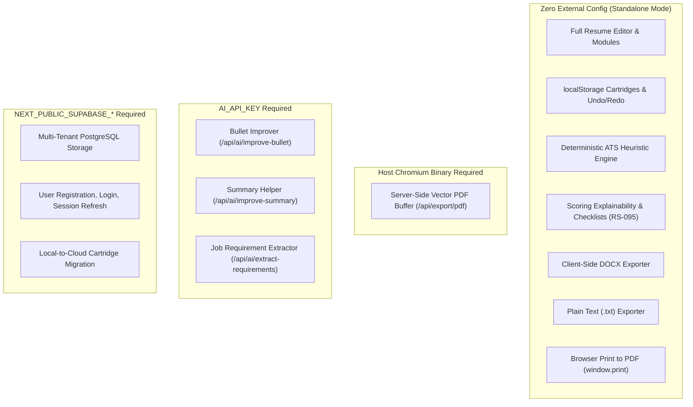

# SoftCV Studio — Production Build & Deployment Smoke-Testing Runbook

**Document Reference:** `DOC-SMOKE-2026-V1`  
**Related Backlog Tickets:** `RS-170`, `RS-171`, `RS-173`, `RS-174`, `RS-082`, `RS-111`  
**Execution Environment:** Node.js 18.18+ / 20+ on Linux, macOS, or Windows  

---

## 1. Overview & Test Classification

This runbook establishes a repeatable procedure for smoke-testing SoftCV Studio as a compiled **production build** (`next build` + `next start`), verifying runtime behavior that cannot be caught by static analysis or isolated unit test environments.

### Local Production Build vs. Deployed Cloud Smoke Test

| Attribute | Local Production Build Smoke Test | Live Deployed Cloud Smoke Test |
|---|---|---|
| **Binary Base** | Production-compiled `.next/` bundle running on local Node.js process | Remote cloud instance (Vercel, AWS ECS, GCP Cloud Run, Fly.io) |
| **Port & Protocol** | `http://localhost:<PORT>` (default test port: `3099`) | `https://<your-subdomain>.domain.com` with TLS termination |
| **Persistence Target** | Browser `localStorage` (demo mode) or local/staged Supabase | Live remote PostgreSQL database (when configured) |
| **Chromium Engine** | Local Playwright headless Chromium binary | Containerized Chromium or headless browser sidecar |
| **Verification Scope** | Route compilation, SSR hydration, client bundle execution, asset serving, local-first workflows, API error status codes, memory bounds | CDN caching, DNS resolution, cold-start latencies, serverless timeout limits, remote SSL handshake |

---

## 2. Environment Variables & Capability Matrix

SoftCV Studio is architected around a **defense-in-depth, zero-crash default** policy. The app is 100% operational in standalone demo mode with **zero environment variables configured**.

### Environment Variable Matrix (Presence / Absence Rules)

> [!IMPORTANT]
> Never print, echo, commit, or log the values of secret tokens. Document presence or absence only.

| Variable Name | Scope | Required / Optional | Capability Unlocked | Fallback Behavior When Absent |
|---|---|---|---|---|
| `NEXT_PUBLIC_SUPABASE_URL` | Client & Server | Optional | Remote multi-tenant cloud storage vault | Falls back automatically to standalone local-first mode (`localStorage`) |
| `NEXT_PUBLIC_SUPABASE_ANON_KEY` | Client & Server | Optional (paired with URL) | Client-side RLS authentication & row reads | Standalone local-first mode (`localStorage`) |
| `AI_API_KEY` | Server Only | Optional | OpenAI-compatible LLM gateway (bullet improver, summary helper, requirements extractor) | Returns HTTP 503 `NOT_CONFIGURED` with accessible candidate warning; zero simulated or fabricated text |
| `AI_MODEL` | Server Only | Optional | Target model selection (default: `gpt-4o-mini`) | Defaults to conservative, high-speed standard model |
| `AI_API_BASE_URL` | Server Only | Optional | Custom proxy or enterprise gateway endpoint | Defaults to `https://api.openai.com/v1` |

---

## 3. Feature Capability Breakdown by Infrastructure



### 1. Features Operating With Zero External Services
- Complete resume authoring across all 5 implemented launch templates (`classic-ats`, `fresher-graduate`, `modern-editorial`, `technical`, `experienced`).
- Bounded in-memory undo/redo ring (30 states) and grouping window.
- Role-specific coaching preset previews (11 archetypes).
- Deterministic ATS Readiness review, including scoring breakdowns, formula disclosures, and checklist filtering.
- Job-specific cartridge branching with deep-copy master immutability (`RS-094`).
- Word document (`.docx`), plain text (`.txt`), and JSON schema backup downloads.
- Browser print-to-PDF (`window.print()`) with `@media print` layout formatting.
- Policy and help pages: `/privacy`, `/terms`, `/help`, `/help/ats-and-ai`, `/release-notes`.

### 2. Features Requiring Host Chromium
- `/api/export/pdf`: Server-side vector PDF generation with selectable text.
- *Expected fallback when Chromium is absent:* The route returns HTTP 500 `{ error: "Failed to generate PDF. You can also use the browser print option as fallback." }`. The client catches this error and surfaces a direct `Print to PDF` action that invokes `window.print()`.

### 3. Features Requiring AI Provider (`AI_API_KEY`)
- `/api/ai/improve-bullet`, `/api/ai/improve-summary`, `/api/ai/extract-requirements`.
- *Expected behavior when unconfigured:* Routes return HTTP 503 `{ ok: false, code: "NOT_CONFIGURED", error: "AI provider API key is not configured..." }`. The UI displays an honest warning and never fabricates mock responses. Client-side heuristic requirement extraction activates automatically as fallback.

### 4. Features Requiring Supabase Authentication & PostgreSQL
- `/auth/login`, `/auth/signup`, `/dashboard` cloud synchronization, and `/api/auth/*`.
- *Expected behavior when unconfigured:* The app runs in Demo Mode. The proxy (`src/proxy.ts`) acts as a passthrough, and the storage hook (`useStorageAdapter`) automatically resolves `localAdapter`.

---

## 4. Local Production Smoke-Test Procedure

### Step 1: Compile Optimized Production Build
```bash
npm run build
```
Verify that the output shows `Compiled successfully` and prerenders all 18 static pages cleanly with 0 TypeScript or build errors.

### Step 2: Run Automated Smoke Suite
The automated production smoke test suite launches the compiled production server on an isolated port (default `3099`) so it never conflicts with local development servers, executes the 9 critical journeys, and guarantees clean process shutdown.

```bash
npm run test:smoke
```

### Step 3: Manual Operator Verification (Optional)
To manually inspect the production build in a browser:
```bash
npx next start -p 3099
```
1. Open `http://localhost:3099` in an Incognito/Private window.
2. Confirm landing page loads with Nintendo 2001 Console Chrome styling.
3. Click **LAUNCH STUDIO (DEMO)** to enter the dashboard.
4. Verify cartridge slots display demo resumes and create a new resume.
5. In the editor, open **ATS READINESS** -> toggle **How This Is Scored** -> verify formulas appear without console errors.
6. Click **EXPORT** -> test **Download DOCX** and **Download PDF**.
7. Shut down the server with `Ctrl+C`.

---

## 5. Automated Production Smoke-Test Matrix (9 Critical Journeys)

| # | Critical Journey | Test Verification Point | Success Criterion |
|---|---|---|---|
| **1** | **Startup & Critical Routes** | `/`, `/dashboard`, `/resume/new`, `/privacy`, `/terms`, `/help`, `/help/ats-and-ai`, `/release-notes` | HTTP 200; zero uncaught JavaScript console exceptions; valid `<title>` and HTML structure |
| **2** | **Local-First Demo Mode** | Access `/dashboard` with unconfigured Supabase | Renders cartridge rack in standalone demo mode; zero credential error prompts |
| **3** | **Resume Lifecycle & Data Isolation** | Create cartridge -> edit candidate name -> reload page -> create 2nd cartridge | State persists across page reloads in `localStorage`; Cartridge A and Cartridge B maintain strict data isolation |
| **4** | **Tailored Variant & Master Immutability** | Branch tailored copy via `createTailoredCopy` -> mutate variant bullet | Variant reflects new bullet; Master cartridge remains byte-for-byte identical; lineage metadata (`parentResumeId`, `targetRole`) retained |
| **5** | **ATS Explainability & Actions (RS-095)** | Open `/resume/[id]/edit` -> click **How This Is Scored** -> filter checklist -> click **Edit in basics** | Disclosure opens with formula `Score = 100 - ...`; checklist filters between All, Incomplete, and Passed; deep link changes active editor section |
| **6** | **Exports in Production Runtime** | Issue `POST /api/export/pdf` with valid payload; compile DOCX blob; simulate missing Chromium | PDF route returns HTTP 200 with `%PDF-` buffer; DOCX returns valid OpenXML blob; missing Chromium returns HTTP 500 with print fallback notice |
| **7** | **Unconfigured AI Route Safety** | Issue `POST` to `/api/ai/improve-bullet`, `/api/ai/improve-summary`, `/api/ai/extract-requirements` without API key | Returns HTTP 503 `NOT_CONFIGURED`; zero unhandled 500 exceptions; zero leaked tokens or stack traces |
| **8** | **Policy & Privacy Pages** | Inspect `/privacy`, `/terms`, `/help/ats-and-ai`, `/release-notes` | HTTP 200; disclaims ATS guarantees; accurately documents local storage and AI routes |
| **9** | **Responsive & Keyboard Accessibility** | Mobile (375×667) and Desktop (1280×800) viewports | Zero horizontal page scrolling (`scrollWidth <= clientWidth`); interactive elements navigable via Tab with visible focus rings |

---

## 6. Hosting Constraints & Deployment Risk Warnings

1. **Process-Local AI Rate Limiting**:
   - The sliding-window rate limiter (`src/lib/ai/rate-limiter.ts`) runs in-memory per Node.js process.
   - On serverless providers (e.g. Vercel, AWS Lambda, Cloudflare Pages), instances do not share memory. If a client distributes requests across multiple ephemeral instances, rate limits are per-instance rather than global.
   - *Production Solution:* In high-traffic deployments, configure a distributed store implementing the `RateLimiterStore` interface (e.g. Upstash Redis or a PostgreSQL token bucket).
2. **Serverless PDF Chromium Execution**:
   - Standard serverless function execution bundles (such as AWS Lambda 50MB zip limits) do not include full Chromium binaries.
   - If deploying to serverless platforms, vector PDF generation via `/api/export/pdf` requires containerized deployment (e.g., Docker on AWS ECS / GCP Cloud Run / Fly.io) or `@sparticuz/chromium`.
   - The application safely provides client-side `window.print()` as an automatic fallback if the server route returns HTTP 500.
3. **Cloud Multi-Tenancy Release Gate (RS-172)**:
   - Authenticated cloud mode backed by Supabase cannot be declared production-ready until the live cross-user PostgreSQL RLS protocol in [`docs/supabase-staging-test.md`](file:///c:/Users/Samujwal/OneDrive/Desktop/resumebuilder/docs/supabase-staging-test.md) is executed against a confirmed disposable staging project.
